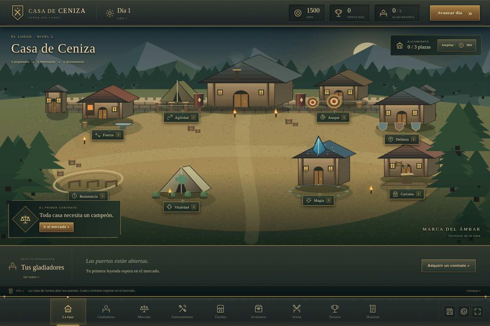

# Casa de Ceniza

Un juego de gestión de gladiadores en español. El jugador dirige una casa: adquiere contratos, descubre talentos, entrena atributos, compra equipo y observa cómo combaten sus gladiadores con su propia IA.

HTML, CSS y módulos JavaScript nativos. Gráficos originales dibujados con Canvas 2D, sonido sintetizado con Web Audio y partidas en LocalStorage. Sin frameworks, CDN, cuentas, API ni dependencias de producción.



[Ver la arena](docs/arena.png) · [Ver la forja](docs/forja.png)

## Abrir y jugar (sin instalar nada)

Descarga el repositorio completo (o el ZIP), **extrae toda la carpeta** y abre `index.html` con doble clic en un navegador moderno. Mantén `style.css` y la carpeta `js` junto a `index.html`. No necesitas Node, Python, conexión a Internet ni un servidor para jugar.

El archivo `js/game.bundle.js` está incluido en el repositorio y se carga como un script clásico, compatible con `file://`. Las fuentes siguen organizadas en módulos para su mantenimiento. Si falta un archivo de arranque, la página muestra un aviso en lugar de quedar en blanco.

Como alternativa para desarrollar o servir el juego por HTTP:

```bash
# Desde la carpeta del proyecto, con Python 3 instalado
python3 -m http.server 8000
```

Abre `http://localhost:8000` en tu navegador. Con Node instalado también puedes usar `npm start`, que ejecuta el mismo servidor. Este servidor es opcional: solo entrega archivos; la lógica y el guardado se ejecutan en el navegador.

## Modificar el código

Para regenerar el archivo listo para jugar necesitas Node y las herramientas de desarrollo fijadas en el lockfile:

```bash
npm ci
npm run build
npm run check:bundle
```

Después de editar archivos de `js/` o `data/`, ejecuta `npm run build` e incluye `js/game.bundle.js` actualizado en el commit. `check:bundle` comprueba que el archivo distribuido corresponde a las fuentes. Esbuild es una herramienta de desarrollo; no se descarga ni se ejecuta al jugar.

## Empezar a jugar

1. Pulsa **Nueva partida**: recibes 1.500 monedas, tres plazas y ocho instalaciones de nivel 1.
2. Visita el **Mercado de Condenados**. Compara historias, rasgos, atributos, talento y precio antes de adquirir un contrato.
3. En **Entrenamiento**, selecciona a un gladiador y asígnale una instalación. Pulsa **Avanzar día** para acumular XP. Puedes cambiarlo de puesto o asignarlo al descanso.
4. Compra en **Tiendas**. Desde **Inventario**, equipa las unidades adquiridas o consume pergaminos para aprender hechizos. Los requisitos se cumplen con atributos, no con el nivel general.
5. Abre **Gladiadores** para ajustar seis preferencias tácticas y preparar hasta cuatro hechizos conocidos.
6. Inscribe al representante en **Arena**. Observa las decisiones, pausa, cambia la velocidad o consulta el razonamiento táctico.
7. Cobra los resultados, descansa y prepara la siguiente competición. El nivel y el prestigio abren circuitos superiores.

Los días son internos: no hay esperas de tiempo real. Los combates son estilizados y no implican muerte permanente.

## Sistemas incluidos

- Generación de personajes adultos con 17 antecedentes, 14 rasgos y apariencia consistente entre fichas, base y arena.
- Ocho atributos y barras de experiencia independientes. El potencial oculto, talento, personalidad, estado físico y nivel de la instalación afectan al aprendizaje.
- Ocho instalaciones con cinco niveles, capacidades reales y figuras animadas. Cinco niveles de alojamiento, hasta 16 gladiadores.
- Mercado renovado cada tres días; feria con descuento cada cinco; evolución de un rival cada siete.
- 20 armas diferenciadas por daño, alcance, velocidad, coste y requisitos; 20 piezas de protección y dos piezas adicionales.
- 12 pergaminos con daño, curación, escudo, debilitamiento, silencio, evasión, control de movimiento y recuperación de energía.
- 13 habilidades distintivas con condiciones, consumo, enfriamientos y dominio creciente.
- Inventario de unidades únicas, siete ranuras, venta al 45 % y exclusión entre armas a dos manos y escudos.
- Combate por turnos con distancia, salud, energía, maná, efectos temporales, guardia, contraataques y movimiento.
- IA de utilidad compartida por ambos bandos. Usa recursos, alcance, equipo, atributos, pasado, personalidad, preferencias, capacidad táctica y memoria observable del rival. El razonamiento muestra los factores que realmente puntuaron la acción.
- Duelos y cuatro torneos: regional, mayor, de campeones y gran campeonato. Hay tres campeones persistentes con estilos propios, rutas de varias rondas, premios y títulos.
- Recuperación entre jornadas y rondas, cuidados pagados, gastos sin deuda y apoyo de un patrocinador cuando queda poco oro.
- Historial de combates y eventos, resultados, prestigio, progresión general sin incrementos automáticos de atributos.
- Guardado automático después de cada acción y turno, continuación de combates, copia previa, importación validada y exportación JSON.
- Controles de pausa, velocidades ×1/×2/×4, sonido opcional y adaptación a pantallas pequeñas.

## Presentación del juego

La interfaz usa un marco de juego a pantalla completa: recursos arriba, navegación inferior y escenas dentro del área central. El botón de las esquinas de la barra inferior activa la pantalla completa cuando el navegador lo permite.

- El ludus se representa como un campamento con edificios en perspectiva, forja, tienda de recuperación, torre arcana, montañas, bosque, antorchas y figuras animadas. Cada instalación se selecciona dentro de la escena.
- Los gladiadores tienen proporciones, rasgos faciales, peinados, barbas, complexión y vestimenta diferenciadas; usan materiales sombreados y articulaciones animadas. Las túnicas arcanas y los pañuelos reflejan el pasado, sin imponer una clase. El equipo real se dibuja sobre el mismo personaje en las fichas, la base y el combate.
- Los coliseos incluyen gradas, público, puertas, banderas, iluminación, polvo, estelas de ataque y efectos de hechizos. El HUD de salud, energía y maná forma parte de la arena. Los efectos propios de curación y escudo se presentan sobre su lanzador.
- Las tiendas usan un expositor de piezas ilustradas y una ficha de inspección. En el arsenal se selecciona cada unidad para equiparla, aprenderla o venderla; el equipo del portador se muestra en ranuras.
- Los fondos se conservan en una caché limitada; personajes, llamas y partículas se animan por separado. No se necesitan imágenes ni fuentes externas.

## Guardado

La clave principal es `casa-ceniza-v1`; `casa-ceniza-v1-backup` conserva la versión válida anterior. Se valida la estructura antes de guardar o cargar. Un guardado dañado intenta recuperar la copia previa y muestra un aviso. Si el almacenamiento está bloqueado o lleno, el juego avisa y permite exportar.

La partida pertenece al origen del navegador: cambiar de puerto, navegador o perfil cambia el espacio de LocalStorage. En modo archivo, algunos navegadores separan el almacenamiento por ubicación del archivo; exporta una copia antes de mover la carpeta. Si el navegador bloquea el almacenamiento, el juego sigue abriendo y permite exportar manualmente. Usa **Opciones → Exportar JSON** para trasladarla. **Nueva partida** e **Importar** piden confirmación antes de reemplazar progreso existente.

Las recompensas se liquidan una sola vez y el estado de un combate se guarda entre turnos. Una pestaña que pierde visibilidad pausa el combate. Evita abrir la misma partida en varias pestañas a la vez: no hay sincronización entre pestañas.

## Pruebas

Las pruebas de lógica no necesitan paquetes. Se verificaron con Node 24:

```bash
npm test
```

La suite contiene 29 pruebas y simula 60 combates completos. Cubre nueva partida; compras individuales y múltiples; falta de oro y capacidad; entrenamiento; mejoras; todas las habilidades y conjuros; requisitos; exclusividad de equipo; magia; IA distinta por personalidad; memoria; legalidad de acciones; días; recuperación; finalización; recompensas idempotentes; torneo completo; guardado, carga y daños en el almacenamiento.

La prueba opcional de navegador requiere Python con Playwright y Chromium. Con el servidor ya iniciado:

```bash
python3 -m pip install playwright
python3 -m playwright install chromium
python3 tests/browser_smoke.py
```

Para usar un Chromium del sistema:

```bash
CHROMIUM_PATH=/usr/bin/chromium python3 tests/browser_smoke.py --screenshots /tmp/ceniza-capturas
```

Comprueba la selección de piezas en los expositores y en el almacén, compras de dos personajes, entrenamiento con incremento de atributo, mejora, equipo, aprendizaje de magia, preferencias, navegación a 1440/1024/390 px, pausa, reanudación tras recargar, recompensa, exportación, importación y rechazo de una copia dañada. Cada ejecución usa un contexto de navegador aislado.

La prueba adicional `CHROMIUM_PATH=/usr/bin/chromium python3 tests/browser_tournament.py` importa una plantilla con atributos altos para verificar rápidamente las dos rondas regionales, el campeón, el título y la bonificación mediante la interfaz real. Esa plantilla se genera exclusivamente dentro de la prueba; no forma parte de las partidas nuevas.

### Regresión de apertura directa

La prueba de apertura desde el disco usa Firefox y Selenium (solo herramientas de prueba). Con Firefox instalado, Selenium puede obtener su controlador o puedes indicar rutas mediante `FIREFOX_PATH` y `GECKODRIVER_PATH`:

```bash
python3 -m pip install selenium
python3 tests/browser_file.py
```

Esta prueba abre el `index.html` real por `file://`, inicia partida, compra, entrena, equipa, recarga y continúa el guardado, pausa y termina un duelo. También comprueba que una copia incompleta, sin el bundle, muestra un aviso de error. No inicia un servidor para el juego.

## Organización

```text
index.html, style.css       Interfaz y presentación
js/boot.js                 Aviso visible si falla el arranque
js/game.bundle.js           Versión incluida para abrir con doble clic
scripts/build.mjs           Generación y comprobación del bundle
js/main.js                 Navegación, eventos, reloj visual y coordinación
js/gameState.js             Estado de partida y reglas de mutación
js/saveSystem.js            Validación, guardado, carga y copia previa
js/gladiators/              Generación y progresión
js/base/                    Instalaciones, calendario, recuperación y eventos
js/economy/                 Mercado, compras, unidades y equipo
js/combat/                  Fórmulas, acciones legales, IA y motor por turnos
js/competitions/            Rivales, duelos, rondas, premios y títulos
js/ui/                     Pantallas, iconos y objetos SVG, personajes, escenarios y sonido
data/                      Catálogos, antecedentes, rasgos y parámetros
tests/                     Pruebas de lógica y flujo de navegador
```

## Equilibrio y alcance de esta versión

Las fórmulas están en `data/rules.js` y `js/combat/combatBalance.js`. La precisión tiene límites de 32 % y 94 %; el peso aumenta el consumo; la guardia reduce daño; la magia consume maná y respeta alcance y recargas. Tras 180 turnos, los jueces comparan la proporción de salud; diferencias inferiores al 4 % dan empate.

El potencial limita el desarrollo sin establecer clases rígidas. Un ladrón puede entrenar fuerza y utilizar un mandoble; la IA recalcula su utilidad con el arma actual.

Los torneos representan la ruta del gladiador seleccionado, con rivales sorteados y un campeón final. No simulan todas las ramas de un cuadro ajeno. La evolución del mundo es por eventos de jornada, no una simulación económica completa de las otras casas. Los gráficos y animaciones son originales, vectoriales y estilizados; la prioridad de esta versión es completar el ciclo jugable y mantener los sistemas ampliables.

No hay backend. La versión lista para jugar ya viene generada. Para publicar el juego basta servir estáticamente el contenido de esta carpeta; se necesita aprobación separada para cualquier publicación externa.
